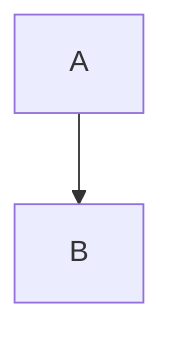

# HTML and Markdown

Ordinary **Markdown**, [[Other|alias]], #local/tag and ==🟢retained==.

<h2>HTML heading</h2>

**literal Markdown** and ![[not-approved]]

<ul>
<li>Quyển sách 007
<li>Second <em>HTML emphasis</em>
</ul>

<table>
<thead><tr><th>Name<th>Count
<tbody><tr><td>Nguyễn<td>42
<tr><td>English<td>003
</table>

<!-- Keep this source comment and &amp; entity spelling. -->

Collapsed source

Retained body.

## Back to Markdown

| Header | Value |
| :--- | ---: |
| **Cell** and [link](note.md) | 123 |

> [!note]- Authored callout
> Body remains present.

$x+1$ and a footnote[^n].

[^n]: Original definition.
