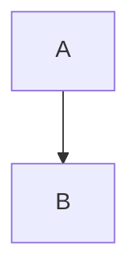

# Nghiên cứu

English and tiếng Việt: 0123456789, quyển sách, Nguyễn. **Bold *nested emphasis***,
~~removed~~, ==highlight **with weight**==, #research/local and #tiếng-Việt.
A hard break.  
Next line &amp; escaped \*text\* and \![[literal]].
[[Child#Section|display alias]], [[Child#^answer]], [ordinary](https://example.invalid),
[reference][ref], <https://example.invalid> and www.example.invalid.

| Name | Detail | Qty |
| :--- | :---: | ---: |
| **Quyển sách** | [link](https://example.invalid/a) and `x\|y` | 42 |
| escaped \| pipe | ==important== and [[Child\|alias]] | 007 |
| short | row |
| overflow | row | 3 | retained extra |

> [!warning]- Collapsed **title**
> Keep this body and its nested list.
> - [ ] unchecked
> - [x] checked
> - [!] custom complete
>   1. ordered child
>   2. second
>
> > [!custom]+ Nested
> > Body with $a^2+b^2=c^2$.

Setext heading
--------------

Footnote reference[^note] and inline ^[An **inline** footnote.].

[^note]: First definition line.
    Continuation with a [link](https://example.invalid).

%% Hidden authored comment ![[not-approved]] and **not parsed**. %%



~~~~javascript
// inert code, never executed
const sample = "![[not-approved]]";
```
~~~~

    indented code: ![[not-approved]]

$$
\begin{aligned} x &= 12 \\ y &= 34 \end{aligned}
$$

<div class="inert"><span data-label="source">**literal HTML body**</span></div>

<!-- HTML comment ![[not-approved]] -->

---

![[Child#Section|Approved section]]

[ref]: https://example.invalid "Reference title"
